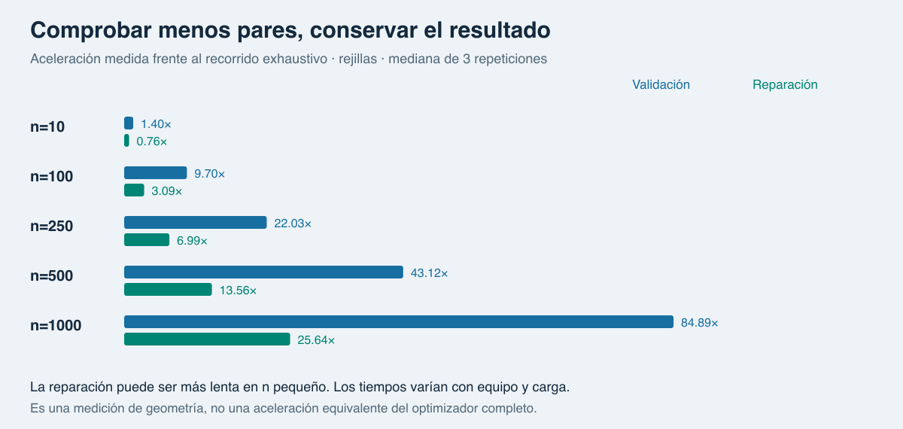
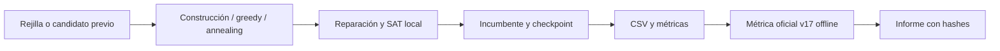

# tAilorPack Lab

Geometría computacional y optimización reproducible para explorar
[Kaggle Squares in Squares](https://www.kaggle.com/competitions/squares-in-squares).

Nombre de repositorio propuesto: **`tailorpack-lab`**. El juego mantiene su nombre
tAilorPack. [Revisión antes de publicar y siguientes pasos](docs/publication-plan.md).

**Proyecto de portfolio v0.1.0.** Construcción geométrica, búsqueda general y
comprobaciones aceleradas hasta 1.000 cuadrados. Candidato validado **offline**
con la métrica oficial v17. Sin envío a Kaggle, ranking ni afirmación de récord.

**También puedes jugar:** [app web lista para Vercel](app/README.md), con tablero
interactivo, rotación, detección de cruces y optimización en segundo plano.


## Resultados que se pueden comprobar

| Caso | Rejilla | Mejor lado guardado | Reducción del lado | Cómo se obtuvo |
|---|---:|---:|---:|---|
| 5 cuadrados | 3 | 2,7071067822 | 9,76 % | Familia constructiva; 45° incluido explícitamente |
| 10 cuadrados | 4 | 3,9100797962 | 2,25 % | Annealing, 10.000 propuestas, mejor semilla 4 |

Para n=10 mejoraron 3 de 10 semillas; la mediana sigue en 4. No se infiere que
el método sea superior en general. La construcción n=5 es un control geométrico,
no un descubrimiento de la búsqueda. Los intentos sin mejora también se conservan.

El [candidato más reciente](examples/m3-best/candidate_NOT_VALIDATED.csv) cubre
**20 puzzles / 1.986 filas**: n=1..16 más 100,250,500,1000. Su
[informe oficial offline](examples/m3-best/official-v17/official_validation.json)
vincula el resultado al SHA-256 exacto del CSV y registra la aceptación de cada
puzzle. Score offline sobre universo n=1..1000, incluidas las penalizaciones de los
omitidos: **28,7782488224**. No es un score recibido del servidor.

## Reproducir en dos comandos

Python **3.11+**; el núcleo usa solo la biblioteca estándar. Desde esta carpeta:

```sh
python3 -m unittest discover -s tests -v
python3 -m tailorpack --max-n 16 --seed 42 --out runs/demo
```

No requiere instalación, credenciales ni GPU. La demo guarda CSV, métricas JSON,
entorno y SVG. En un mismo entorno, configuración y fuentes iguales producen
resultados deterministas. Las diferencias de trigonometría entre plataformas
pueden afectar los últimos bits.

**37 tests en la suite**: 32 ejecutables sin dependencias adicionales y 5
regresiones opcionales contra el notebook oficial. Los 37 pasaron en el entorno
local preparado; sin notebook los cinco opcionales se omiten explícitamente.
La [CI](.github/workflows/tests.yml) define Python 3.11–3.13; aún no se ha ejecutado
en GitHub porque el repositorio no se ha publicado.

## Búsqueda y escala

```sh
# Comparar greedy y annealing en diez semillas
python3 -m tailorpack.benchmark --ns 10 --evaluations 10000 --out runs/search-n10

# Cinco tamaños, dos semillas, procesos y checkpoints
python3 -m tailorpack.scale --ns 10 100 250 500 1000 --seeds 0 1 \
  --evaluations 30 --workers 2 --checkpoint-every 10 \
  --warm-start examples/m2-best/candidate_NOT_VALIDATED.csv --out runs/scale

# Regenerar las figuras SVG a partir de los resultados guardados
python3 -m tailorpack.portfolio
```

Repetir el comando de escala recupera trabajos completos o continúa desde el
último checkpoint. Guarda RNG, paso, configuración, hash del motor, estado actual
y mejor solución. Para cambiar presupuesto o motor, usar otra carpeta; la
reanudación exacta mantiene el horizonte original. `evaluations` cuenta propuestas,
incluidas las reparaciones descartadas, no tiempo ni llamadas al evaluador oficial.



En n=1000, la validación espacial revisó 3.811 candidatos frente a 499.500 pares:
≈85× en validación y ≈26× en reparación, mediana de tres repeticiones de esta
carga. El CSV secuencial y paralelo coincidió byte a byte. Son mediciones de
geometría e infraestructura, no una aceleración universal ni una campaña larga
de optimización. [Datos y límites](docs/scaling.md).

## Contrato de Kaggle y validación

Verificado el **23-10-2026** en fuentes primarias: n=1..1000, cuadrados unitarios,
centros continuos, ángulos en radianes, interiores sin intersección y contenedor
cuadrado alineado a ejes. CSV: `id,n,square_id,x,y,angle`; el lado L se calcula.
La métrica suma `L/sqrt(n)-1`, menor es mejor; un puzzle omitido recibe la
penalización de la rejilla. Se omiten puzzles completos, no cuadrados individuales.

El núcleo usa floats y SAT. El adaptador importa **sin modificar** el notebook
oficial, comprueba el hash revisado y conserva los literales del CSV como cadenas.
La validación oficial usa sus propias comprobaciones de intervalos. Para repetirla,
descargar el notebook v17 y sample desde Kaggle a `data/official/` y seguir
[estas instrucciones](docs/official-validation.md). Los archivos originales no se
redistribuyen. Nuevas versiones requieren revisión y otro hash.

`candidate_NOT_VALIDATED.csv` es el nombre conservador de todo archivo generado:
generarlo no lo valida. Un informe oficial offline solo acredita el CSV cuyo hash
registra. La aceptación en la plataforma exige una respuesta de Kaggle.

## Arquitectura



| Ruta | Responsabilidad |
|---|---|
| `tailorpack/geometry.py` | Cuadrados, SAT y filtro espacial; referencia exhaustiva |
| `tailorpack/solvers.py`, `search.py` | Construcción, movimientos, reparación y checkpoints |
| `tailorpack/benchmark.py`, `profile_scale.py` | Comparaciones por semilla y rendimiento |
| `tailorpack/scale.py` | Warm starts, catálogo y procesos paralelos |
| `tailorpack/official.py` | Adaptador aislado del notebook oficial con hash fijado |
| `tailorpack/export.py`, `render.py`, `portfolio.py` | CSV, SVG y galería |
| `tests/`, `tools/check_release.py` | Tests y comprobaciones de la entrega |
| `examples/` | Datos de referencia, candidatos e informes |

## Qué demuestra y qué falta

Demuestra un proceso completo: formular el problema, conservar controles,
experimentar con presupuesto fijo, validar el resultado serializado, medir coste,
reanudar exactamente y presentar resultados junto con sus fracasos.

La meta de calidad de M2 sigue abierta: la búsqueda solo añadió una mejora nueva
en n=10. Falta diversidad de inicializaciones, movimientos colectivos y mejores
resultados consistentes. El filtro espacial conserva peor caso cuadrático.
M3 se comprobó con tamaños representativos y presupuestos cortos, no con una
campaña competitiva sobre todos los puzzles. No se prometen récords ni premios.

## Informe y publicación

- [Caso de estudio de portfolio](docs/portfolio-case-study.md)
- [Búsqueda, ablations y resultados negativos](docs/search-results.md)
- [Mediciones de escala y reanudación](docs/scaling.md)
- [Reglas verificadas y procedencia](docs/verification.md)
- [Arquitectura y estado M0–M4](docs/architecture-roadmap.md)
- [Notas de la versión](CHANGELOG.md) y [preparación para GitHub](docs/github.md)

Apache 2.0 está incluida como [propuesta de licencia](docs/LICENSE-Apache-2.0.proposed.txt)
para revisión del propietario antes de publicar. No se ha aplicado una licencia
definitiva ni publicado repositorio, release o predicción. La revisión de
[procedencia](docs/provenance.md) separa código propio, fuentes y archivos externos.
