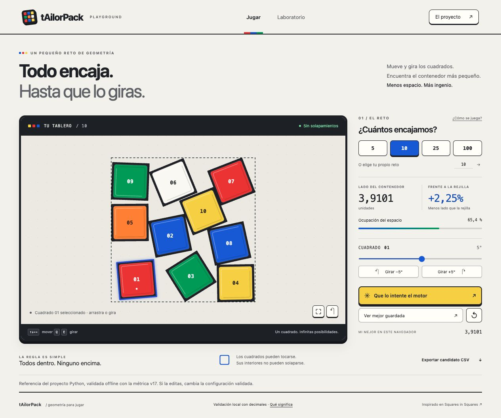
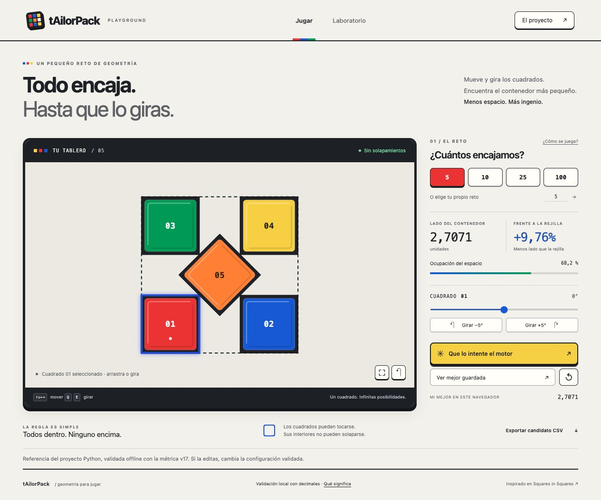

# tAilorPack Lab

[Versión en castellano](#versión-en-castellano) · [English version](#english-version)

## Versión en castellano

**Autora: Araceli Fradejas Muñoz.**

> Todo encaja. Hasta que lo giras.

tAilorPack es mi proyecto para experimentar con geometría y optimización a partir de [Squares in Squares de Kaggle](https://www.kaggle.com/competitions/squares-in-squares). La idea parece sencilla: colocar cuadrados dentro de otro cuadrado y ocupar el menor espacio posible. En cuanto empiezas a girar las piezas, deja de serlo.

Después de tAilorCode quería seguir aprendiendo con un reto que pudiera llevar a mi portfolio y que también fuera divertido de probar. Por eso el proyecto tiene dos partes: un laboratorio en Python para comparar resultados y una app donde puedes mover las piezas, girarlas y dejar que el ordenador intente mejorar tu solución.

La estética está inspirada en los colores y las piezas de un cubo de Rubik: caras de colores, bordes oscuros y un tablero que invita a tocar. La mecánica sigue siendo la de empaquetar cuadrados.

**Demo:** [Jugar a tAilorPack en Vercel](https://tailorpack-lab.vercel.app/). · **[Memoria del proyecto](MEMORIA.md)**



<details>
<summary>Ver la referencia de cinco cuadrados</summary>



</details>

### Qué puedes hacer

- Elegir el número de cuadrados, entre 1 y 1.000.
- Mover piezas con el ratón o las flechas y girarlas con los controles o con Q/E.
- Ver si las piezas se cruzan, cuánto mide el contenedor y qué espacio ocupan.
- Deshacer, volver a la rejilla y ajustar la vista al conjunto.
- Ejecutar la búsqueda automática sin bloquear los controles de la página.
- Cargar las referencias de cinco y diez cuadrados y exportar la configuración a CSV.
- Conservar tu mejor resultado válido en el navegador.

Los récords se guardan en `localStorage`. No hay cuenta, servidor de partidas ni sincronización entre dispositivos. La app no necesita claves de API ni hace llamadas a un modelo de IA.

### Decisiones del proyecto

He separado el dibujo del tablero, la geometría, la búsqueda y el guardado de resultados. Así puedo cambiar el aspecto del juego sin tocar las reglas que comprueban las piezas.

La app utiliza JavaScript vanilla y SVG. Para este tablero no necesitaba incorporar React ni un backend. La optimización se ejecuta en un Web Worker para que la página siga respondiendo mientras busca.

En Python mantengo una rejilla como punto de partida y comparo construcción geométrica, búsqueda greedy y simulated annealing. Guardo semillas y presupuestos para poder repetir los experimentos. Los checkpoints permiten continuar una búsqueda sin empezar desde cero.

### Comparar motores · v0.2

He añadido una segunda estrategia con otros puntos de partida, reinicios y movimientos de grupos de piezas. En **Laboratorio → Comparar actual y nuevo** puedes ejecutar ambos motores con el mismo tablero, semilla y presupuesto por motor. Se conserva el mejor resultado recibido; v1 sigue siendo la opción por defecto.

En 240 ejecuciones, la v2 mejora los casos de 5, 17 y 37 cuadrados desde la rejilla. Las mejoras proceden de una construcción preparada: cuando ambos motores reciben ese mismo inicio, empatan. En los otros seis tamaños probados no hay mejora. La v2 también necesita más tiempo. He conservado los resultados y las limitaciones en el [informe v0.2](docs/search-v02.md).

### Resultados y relación con Kaggle

| Caso | Lado de la rejilla | Mejor lado guardado | Origen |
| --- | --- | --- | --- |
| 5 cuadrados | 3 | 2,7071067822 | Construcción geométrica con el centro girado 45° |
| 10 cuadrados | 4 | 3,9100797962 | Annealing; mejor resultado de diez semillas |

En diez cuadrados mejoraron tres de las diez semillas; la mediana quedó en 4. El caso de cinco cuadrados es una referencia preparada, no un descubrimiento de la búsqueda.

El [candidato guardado](examples/m3-best/candidate_NOT_VALIDATED.csv) contiene veinte puzzles y 1.986 filas. Se comprobó **offline con el evaluador oficial v17** y obtuvo 28,7782488224 sobre los 1.000 puzzles, incluidas las penalizaciones de los omitidos. Todavía no he enviado una submission a Kaggle.

La comprobación del navegador usa decimales de JavaScript. Exportar un CSV desde el juego no significa que Kaggle lo haya aceptado: debe pasar por la validación oficial. El nombre `candidate_NOT_VALIDATED.csv` se mantiene como precaución para los archivos generados; el [informe](examples/m3-best/official-v17/official_validation.json) identifica por su huella el candidato exacto que se evaluó.

### Tecnologías y estructura

- Python 3.11 o posterior, con biblioteca estándar en el núcleo.
- JavaScript con ES Modules, HTML, CSS y SVG.
- Web Workers y Local Storage.
- `unittest`, tests de Node.js y GitHub Actions.
- Vercel para servir la app estática.

```text
.
├── README.md
├── MEMORIA.md
├── app/          # Juego web, estilos y tests
├── tailorpack/   # Geometría, búsqueda y exportación en Python
├── tests/        # Pruebas de Python
├── examples/     # Resultados conservados de los experimentos
├── docs/         # Capturas, reglas y documentación técnica
└── tools/        # Comprobación de referencias y documentación
```

### Ejecutar la app

Requiere Node.js 22 o posterior.

```sh
git clone https://github.com/AraceliFradejas/tailorpack-lab.git
cd tailorpack-lab/app
npm ci
npm run dev
```

Abre la dirección local que aparece al arrancar. Para comprobar la construcción de producción:

```sh
npm test
npm run build
```

La [guía de la app](app/README.md) explica su estructura y configuración en Vercel.

### Repetir un experimento en Python

Desde la raíz del repositorio:

```sh
python3 -m unittest discover -s tests -v
python3 -m tailorpack --max-n 16 --seed 42 --out runs/demo
```

El núcleo no requiere instalación ni GPU. Para repetir la validación oficial hacen falta el notebook descargado de Kaggle y las [dependencias opcionales](docs/official-validation.md).

### Comprobaciones y próximos pasos

Hay 22 tests web y 37 tests Python: 32 se ejecutan sin dependencias adicionales y cinco necesitan el entorno oficial. GitHub Actions comprueba Python 3.11, 3.12 y 3.13 y construye la app. Puedes consultar las [ejecuciones](https://github.com/AraceliFradejas/tailorpack-lab/actions).

Quiero ampliar las inicializaciones y los movimientos para conseguir mejoras más consistentes. También me interesa comparar una política aprendida con la búsqueda actual, pero todavía no he entrenado un modelo. Los resultados actuales son una base de aprendizaje.

### Documentación

- [Memoria del proyecto](MEMORIA.md).
- [Reglas verificadas](docs/verification.md) y [validación oficial](docs/official-validation.md).
- [Comparación v0.2](docs/search-v02.md).
- [Búsqueda y resultados](docs/search-results.md) y [pruebas de escala](docs/scaling.md).
- [Arquitectura y evolución](docs/architecture-roadmap.md).
- [Procedencia, autoría y licencia](docs/provenance.md).

### Autora

**© 2026 Araceli Fradejas Muñoz · tAilorPack**

[GitHub](https://github.com/AraceliFradejas) · [LinkedIn](https://www.linkedin.com/in/araceli-fradejas-munoz-transformaciondigital/) · [X](https://x.com/AraceliFradejas) · [Medium](https://medium.com/@araceli.fradejas) · [YouTube](https://www.youtube.com/@aracelifradejasmunoz2758)

Proyecto desarrollado con asistencia de OpenAI Codex. Licencia [Apache 2.0](LICENSE). La estética del cubo es una inspiración visual; el proyecto es independiente.

---

## English version

**Author: Araceli Fradejas Muñoz.**

> Everything fits. Until you rotate it.

tAilorPack is my geometry and optimization project inspired by [Kaggle Squares in Squares](https://www.kaggle.com/competitions/squares-in-squares). The task is to fit unit squares inside the smallest possible square container.

After tAilorCode, I wanted another challenge I could learn from, include in my portfolio and enjoy trying. The project combines a reproducible Python lab with an interactive web app. Its colourful faces and dark edges take visual inspiration from a Rubik's cube.

**Demo:** [Play tAilorPack on Vercel](https://tailorpack-lab.vercel.app/). · **[Project report, in Spanish](MEMORIA.md)**


### What you can do

Move and rotate squares, check overlaps and container size, undo changes, run an automatic search, load the five- and ten-square references, and export a CSV. Valid personal records stay in your browser's Local Storage.

The app uses vanilla JavaScript, SVG and a Web Worker. It has no accounts, game server or AI API. Python provides grid and constructive baselines, greedy search, simulated annealing, checkpoints and reproducible experiments.

### Compare engines · v0.2

In **Laboratorio → Comparar actual y nuevo**, both engines receive the same starting board, seed and proposal budget. The experimental v2 adds restarts, group moves and explicit geometric starts. The original v1 remains the default.

Across 240 runs, v2 improves the 5-, 17- and 37-square grid starts. These gains come from the explicit construction: both engines tie when given the same constructed start. Neither improves the other six tested sizes. V2 takes more time. See the [v0.2 report, in Spanish](docs/search-v02.md).

### Results and scope

The saved five-square construction reduces the container side from 3 to 2.7071067822. The best ten-square search reduces it from 4 to 3.9100797962; only three of ten seeds improved, and the median remained 4.

The saved candidate covers twenty puzzles and 1,986 rows. It was validated **offline against Kaggle's official v17 evaluator**, with a score of 28.7782488224 over the 1,000-puzzle universe, including missing-puzzle penalties. No Kaggle submission has been sent. Browser validation and a downloaded CSV do not establish official acceptance.

### Run locally

With Node.js 22 or later:

```sh
git clone https://github.com/AraceliFradejas/tailorpack-lab.git
cd tailorpack-lab/app
npm ci
npm run dev
```

Run `npm test` and `npm run build` from `app/`. From the repository root, Python 3.11 or later runs the lab without additional dependencies:

```sh
python3 -m unittest discover -s tests -v
python3 -m tailorpack --max-n 16 --seed 42 --out runs/demo
```

There are 22 web tests and 37 Python tests, including five optional official-evaluator checks. [GitHub Actions](https://github.com/AraceliFradejas/tailorpack-lab/actions) checks Python 3.11–3.13 and the web build. A trained policy remains a future experiment; the current optimizer is not a trained AI model.

### Author

**© 2026 Araceli Fradejas Muñoz · tAilorPack**

[GitHub](https://github.com/AraceliFradejas) · [LinkedIn](https://www.linkedin.com/in/araceli-fradejas-munoz-transformaciondigital/) · [X](https://x.com/AraceliFradejas) · [Medium](https://medium.com/@araceli.fradejas) · [YouTube](https://www.youtube.com/@aracelifradejasmunoz2758)

Developed with OpenAI Codex assistance. [Apache 2.0](LICENSE). See the Spanish [project report](MEMORIA.md) and [provenance](docs/provenance.md) for the technical journey and external sources.
