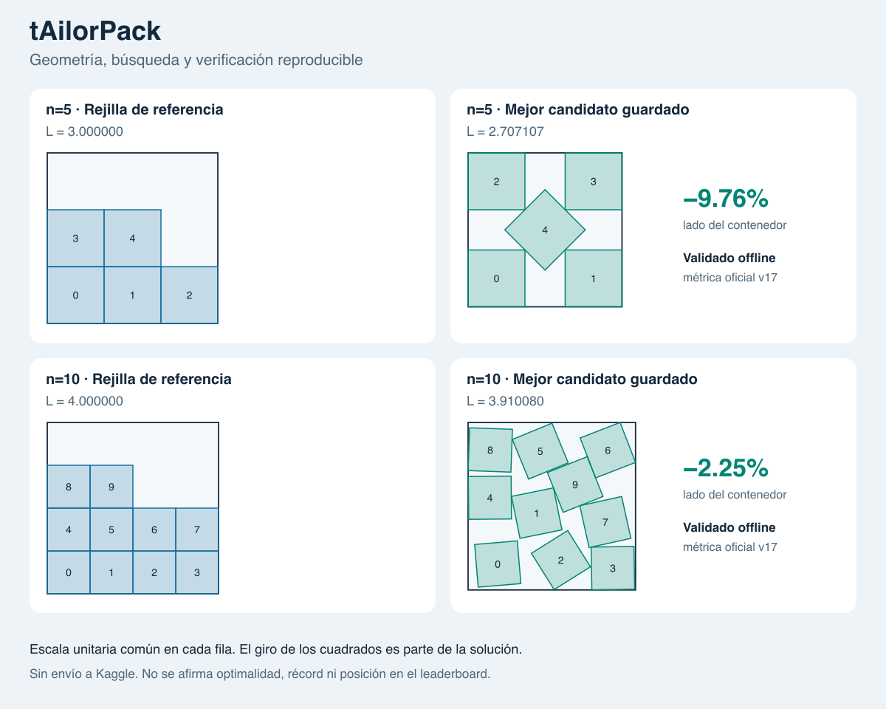

# tAilorPack — De una construcción a un experimento verificable

## Problema

Empaquetar cuadrados unitarios en el menor contenedor cuadrado combina una
representación sencilla con una optimización difícil. Un movimiento que mejora
el lado puede introducir un solapamiento minúsculo y convertir una aparente
mejora en una solución inválida. El objetivo de este proyecto fue construir una
base de portfolio reproducible, no prometer un récord competitivo.

El contrato se contrastó en las páginas de descripción, evaluación, datos y reglas
de [Kaggle](https://www.kaggle.com/competitions/squares-in-squares), y después se
descargaron sample y notebook v17. [Evidencia](verification.md).

## Decisiones que importan

**Control antes de optimizar.** La rejilla da una solución factible con lado
ceil(sqrt(n)). Para n=5, una familia de cuatro cuadrados en las esquinas y uno
central girado permite comparar una construcción explícita con la rejilla. Se
incluyó 45° a propósito: las muestras aleatorias no descubrieron esa solución.

**Separar buscar de certificar.** El solver mueve centros y ángulos usando floats;
una reparación expande los centros hasta separar pares sobre un eje SAT. El
incumbente nunca se sustituye por una solución localmente inválida. La métrica
oficial se ejecuta después sobre el CSV, preservando sus cadenas decimales.
El informe se vincula a su hash, no al nombre del archivo.

**Comparaciones acotadas.** Greedy y annealing reciben igual número de propuestas,
diez semillas y la misma política de inicio. La media, mediana y dispersión evitan
presentar la mejor semilla como si fuese el comportamiento habitual.

**Medir antes de añadir dependencias.** Un filtro espacial reduce pares candidatos.
Se mantiene la referencia exhaustiva y se comparan ambas salidas. El núcleo sigue
sin dependencias, GPU ni servicios remotos.

## Resultado

| Evidencia | Resultado | Límite de la conclusión |
|---|---|---|
| Construcción n=5 | L≈2,7071067822 frente a 3 | Candidato explícito de 45°, no descubrimiento de búsqueda |
| Búsqueda n=10 | L≈3,9100797962 frente a 4 | 3/10 semillas mejoran; mediana 4 |
| Geometría n=1000 | ≈85× validación; ≈26× reparación | Rejillas y tres repeticiones, no toda carga posible |
| Procesos | CSV secuencial/paralelo idéntico | El coste de procesos puede penalizar tareas cortas |
| Reanudación | Igualdad con ejecución ininterrumpida | Configuración, código y horizonte deben mantenerse |
| Suite local completa | 37 tests correctos | La CI remota todavía no se ejecutó |
| Candidato final | 20 puzzles aceptados offline por v17 | No enviado ni aceptado en plataforma |

El score offline pasa de 28,9376699166 para la rejilla de referencia a
28,7782488224 para el candidato combinado, usando universo n=1..1000 y
penalizaciones para omitidos. El resultado final conserva n=5 y n=10 mejorados;
los casos grandes añadidos son rejillas. Añadirlos no cambia el score de M2.
Fuente: [informe final](../examples/m3-best/official-v17/official_validation.json).

## Qué no funcionó y qué aprendimos

La primera campaña de 100 búsquedas con 2.000 propuestas no mejoró los incumbentes.
En una campaña posterior más amplia, aumentar temperatura y presupuesto permitió
mejorar n=10, pero no 11,12,13. La selección de n=10 para la prueba final es
exploratoria, sin conjunto reservado: no respalda una superioridad general del
annealing. [Configuraciones y resultados](search-results.md).

Desde una inicialización floja de n=5, greedy mejoró las diez semillas y superó
annealing en ese presupuesto. Ninguno superó la construcción explícita de 45°.
El algoritmo más complejo no ganó automáticamente.

La reparación uniforme es fácil de razonar y verificar, pero una colisión puede
expandir toda la configuración. Esto dificulta reorganizar una rejilla densa.
El siguiente trabajo de optimización debe probar movimientos colectivos e
inicializaciones diversas, no limitarse a aumentar el presupuesto.

## Reproducibilidad y entrega

La [guía de inicio](../README.md) ejecuta el núcleo en Python 3.11+ sin instalación.
Los experimentos guardan configuración, hash de fuentes y entorno; los tiempos van
separados de resultados deterministas. Checkpoints JSON conservan RNG e incumbente.
Los ficheros externos de Kaggle quedan fuera de la entrega. La propuesta de
licencia y su revisión están en [procedencia](provenance.md).

La preparación local de M4 está terminada: README, galería, caso de estudio,
notas de versión, evidencia y paquete revisable. Elegir licencia definitiva,
publicar GitHub y enviar a Kaggle siguen siendo decisiones del propietario.
